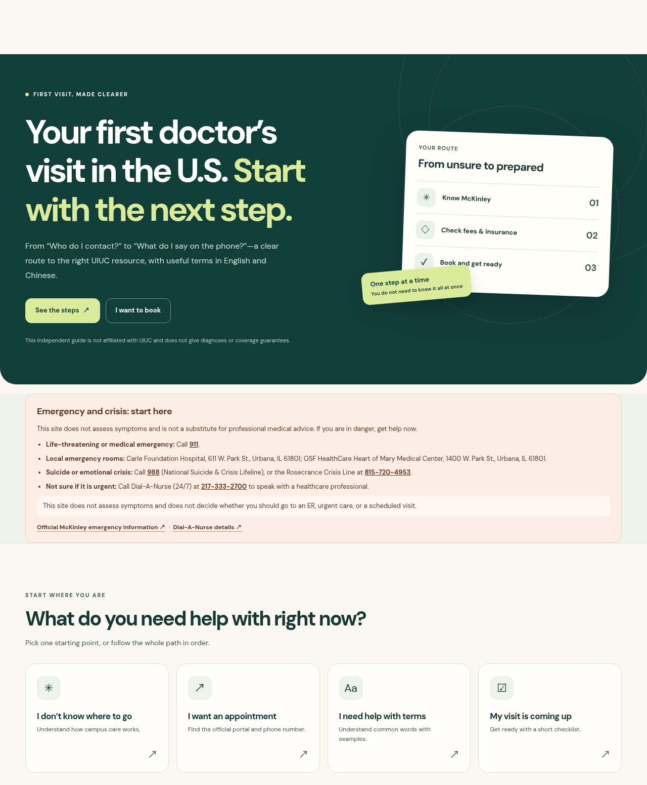
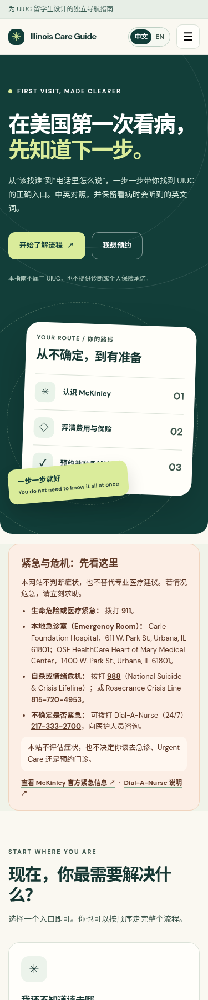

# Illinois Care Guide

**A multilingual healthcare navigation guide for UIUC international students making a first doctor’s visit in the U.S.**

[](https://shroudxk.github.io/uiuc-care-guide/)
[](https://shroudxk.github.io/uiuc-care-guide/)

**Live site:** https://shroudxk.github.io/uiuc-care-guide/

The published site updates when changes on `main` are deployed. A branch preview does not count visits.

<p align="center">
  
</p>

<p align="center">
  
</p>

---

## 简介

面向 UIUC 国际学生的多语言就医导航。把“该找谁、怎么约、费用和保险怎么分、电话怎么说、就诊前带什么”收成一条清晰路径，并链回官方页面。界面语言可以用选择器切换：English、简体中文、繁體中文、한국어、हिन्दी。看病时要说的英文句子会保留，并附上当前语言的说明。**本站不评估症状、不做诊断、不保证保险覆盖。紧急情况请拨打 911。** 译文未经母语者临床复核，行动前请核对官方英文页面。

---

## The problem

International students at UIUC often can *find* health information online, but still struggle to turn it into action:

- Unclear where to start for non-emergency care (campus clinic vs. insurance office vs. outside care)
- Unfamiliar terms (primary care, referral, copay, deductible, in-network)
- Uncertainty about what to say when calling to book
- Difficulty separating the **Campus Health Service Fee** from **Student Health Insurance**

Illinois Care Guide turns that confusion into a short, scannable route: understand campus care → check who pays → book and prepare. The same steps are available in five languages. English clinic words stay on the page so they can be read aloud.

---

## What the guide covers

| Section | What you get |
| --- | --- |
| **Emergency & crisis** | 911, local ERs (Carle / OSF Heart of Mary), 988, Rosecrance Crisis Line, Dial-A-Nurse 24/7 — plus a clear note that this site does **not** assess symptoms |
| **Start where you are** | Four entry points: where to go · book an appointment · understand terms · pre-visit checklist |
| **Four-step journey** | Emergency check → know McKinley / Primary Care Provider → separate fee vs. insurance → book & prepare |
| **Fee vs. insurance** | How the Campus Health Service Fee differs from Student Health Insurance; McKinley does not accept health insurance or bill insurers directly (Billing Statement for possible reimbursement); referral notes; insurance office contacts |
| **Booking** | MyMcKinley portal link, phone booking number, sample call phrases in English with an explanation in the selected language, cancellation note from the official appointments page |
| **Terms + checklist** | Searchable glossary (plain explanations + illustrative examples + an English question and a plain-language gloss); browser-local pre-visit checklist |
| **Official sources** | Direct links to McKinley, Dial-A-Nurse, Referral Services, Student Health Insurance FAQ / contact / glossary, and emergency pages |

Each main block shows a source line with **Reviewed 2026-11-08** and links to the matching official UIUC pages.

---

## Languages

The language control is a button that opens a list. Each option uses the language’s own name (English, 简体中文, 繁體中文, 한국어, हिन्दी). There are no country flags. The choice is saved in this browser under `icg-language`. Changing language does not clear the checklist (`icg-checklist`).

If no choice is saved, the page follows the browser’s language list (`navigator.languages`) and falls back to English. A saved choice always wins over the browser. The page does not read location, and it does not guess a nationality. An `en-IN` browser stays in English; Hindi appears only when Hindi is in the browser languages or the visitor chooses हिन्दी.

Older visits that stored `zh` or `zh-CN` open in 简体中文.

| Language | Native name | `html lang` | Why it is included |
| --- | --- | --- | --- |
| English | English | `en` | Default. Campus and insurance pages are in English, and English stays one tap away. |
| Simplified Chinese | 简体中文 | `zh-Hans` | Largest origin in the Fall 2025 count below. |
| Traditional Chinese | 繁體中文 | `zh-Hant` | Taiwan is the fourth-largest origin. Wording follows usage common in Taiwan (for example 資訊, 網路, 預約, 初級照護, 自負額, 理賠). |
| Korean | 한국어 | `ko` | South Korea is the third-largest origin. |
| Hindi | हिन्दी | `hi` | An additional option. India is the second-largest origin, and India is multilingual. Hindi is **not** treated as the language of students from India. |

These translations are navigation aids. They have **not** had native-speaker clinical review. They are not medical advice. The page asks readers to check the official English source before acting. Phone numbers, 911, 988, street addresses, dollar examples, and official names are copied rather than rewritten.

### Where the language set comes from

Country or territory of origin is not a language census, and it does not establish what a student prefers to read. The set above is limited to English plus the languages with a large origin share and a shared written standard. No other language is included from these figures alone.

Latest official by-country report: **Fall 2025, not Fall 2026.** ISSS describes the count as enrolled, full-time international students studying in person in the United States. Students on OPT are not in this denominator.

- Statistics page: https://isss.illinois.edu/about/statistics/
- Fall 2025 PDF: https://isss.illinois.edu/wp-content/uploads/2026/10/ISSS-FallStatisticsBook-2025-Digital_Updated.pdf
- Scope note: https://isss.illinois.edu/about/requesting-data/

Denominator: **12,275** students. Shares below are count ÷ 12,275.

| Rank | Country / territory | Count | Share |
| --- | ---: | ---: | ---: |
| 1 | China | 5,918 | 48.2% |
| 2 | India | 2,255 | 18.4% |
| 3 | South Korea | 840 | 6.8% |
| 4 | Taiwan | 533 | 4.3% |
| 5 | Bangladesh | 156 | 1.3% |

The top four origins are 9,546 students, **77.8%**. Bangladesh is next, at 1.3%, which is why no further language was added. The same PDF also lists Hong Kong (69) and Macau (6); Traditional Chinese on this site is still written with Taiwan usage, and those counts are not a claim about which script someone prefers.

Do not mix in the “including OPT” total (16,144 on the historical chart). That chart has no country split.

Figures were taken from the Fall 2025 PDF (top sending countries and regional tables), checked against the ISSS statistics page as of the research notes dated 2026-11-09. This healthcare page does not display the table.

---

## Who it’s for

- UIUC international students arranging a **routine / non-emergency** first visit
- Readers who want **English, Simplified Chinese, Traditional Chinese, Korean, or Hindi** for the same steps
- Friends or family helping a student navigate campus care and insurance contacts

---

## How to use

1. Open the [live site](https://shroudxk.github.io/uiuc-care-guide/).
2. Open **Language** and choose a name. The choice is saved in the browser.
3. Start from an emergency check if needed, or pick one of the four entry cards.
4. Follow the journey in order, or jump to booking / terms / checklist.
5. Read the English phone script aloud. The lines under it explain that script in the language you selected.
6. When in doubt, use the **official source** links on each section. Prefer the official English page if a translation and the source disagree.

---

## Tech stack & local run

Plain static site — no build step, no backend. Relative URLs keep the GitHub Pages project path (`/uiuc-care-guide/`) working.

```
index.html            # shell, early language hint, analytics opt-out before consent
styles.css            # layout and theme
app.js                # rendering, language picker, checklist, glossary search
official.js           # official UIUC URLs only
i18n.js               # language order, storage migration, browser-language match
analytics.config.js   # GA4 measurement ID
analytics.js          # consent gate, canonical page view, request sanitizer
locales/*.js          # English, Simplified Chinese, Traditional Chinese, Korean, Hindi
```

**Hosted on** [GitHub Pages](https://shroudxk.github.io/uiuc-care-guide/) from this repository’s `main` branch (site files at the repo root).

**Run locally**

```bash
# Option A — open the file
open index.html          # macOS
xdg-open index.html      # Linux

# Option B — local server (recommended)
python3 -m http.server 8080
# then visit http://localhost:8080
```

Local and preview hosts do not send analytics.

**Tests**

```bash
npm install
npx playwright install chromium
npm test
```

`npm test` checks locale key parity and factual strings, then runs Chromium behavior and privacy tests at desktop (1280×800) and mobile (390×844). Unit tests alone: `npm run test:unit`.

---

## Visit statistics and privacy

The published site can count visits with Google Analytics 4. The measurement ID is `G-68T1ZEGEJX` (a Measurement ID, not a Google Tag Manager container). Property `563468689`, account `415635477`, web stream `16308642891`.

The tag is **not** in the page HTML. It is added only when all of the following are true:

- the host is `shroudxk.github.io` (localhost, file previews, and automated tests are suppressed unless a test explicitly opts in and intercepts the request)
- the visitor has chosen **Accept visit count**
- the browser is not sending Do Not Track or Global Privacy Control

Decline is stored. Revoke sets measurement off, deletes first-party Analytics cookies (`_ga`, `_ga_68T1ZEGEJX`, and related `_gid` / `_gat` names), and reloads the page. Nothing is sent before acceptance, after decline, or after revoke — including cookieless consent pings, because the Google script is not loaded in those states.

After acceptance the tag is configured with `send_page_view: false`, then one explicit `page_view`. The page title sent is always `Illinois Care Guide`, not the translated document title. The page address is the canonical homepage with the query string and hash removed. The referrer, if sent, is reduced to an origin with no path, query, or hash. `allow_google_signals` and `allow_ad_personalization_signals` are false. Consent state sets `ad_storage`, `ad_user_data`, and `ad_personalization` to denied, and `analytics_storage` to granted only after acceptance.

A network guard rewrites or drops Google Analytics collect hits. It removes emails, user IDs, search parameters, and ad click IDs; forces the generic title; strips query strings and hashes; and blocks event names other than `page_view`, `session_start`, `user_engagement`, and `first_visit`. A second `page_view` on the same page load is dropped so a hash change cannot become another page. Ads hosts such as DoubleClick are blocked. The site does not send language changes, search text, checklist selections, section links, or other healthcare actions.

Property settings confirmed by the maintainer on 2026-11-10: Enhanced measurement off, Google signals off, ads personalization disallowed in all regions, optional data sharing off, retention 2 months. Also keep **Reset user data on new activity** off when that control is available, so the 2-month window does not restart, and keep **email redaction** on for the web stream. Enhanced measurement must stay off; history page views, site search, scroll, outbound clicks, and form events are exactly the fields this guide must not collect. Code cannot replace those admin switches.

This is not fully anonymous. After acceptance Google may store a client identifier and receive technical fields the tag adds (for example screen or browser language). Google’s own description is that IP addresses are used for coarse location and spam checks and are not stored as a report dimension; do not describe the hit as anonymous. Broad location and device collection is turned off in the property, which limits what reports show. It does not remove every technical field from the hit.

**Where to read the numbers.** Sign in to the Google account that can open the property:

https://analytics.google.com/analytics/web/#/a415635477p563468689/reports/intelligenthome

Use `page_view` counts for the canonical homepage. Do not treat user or session totals as unique students. The count misses anyone who declined, anyone whose browser sends Do Not Track or Global Privacy Control, and all localhost or preview traffic. It says nothing about symptoms, checklist use, language preference, or country of origin. User-level and event-level retention is 2 months; standard aggregated reports can still show older totals, which is a Google Analytics limitation rather than a second dataset on this site.

Google Analytics terms prohibit sending personal information and data that may reveal sensitive information. This integration is only a consented count of the public landing page. The guide is not a clinic record. Google does not offer a Business Associate Agreement for Analytics; no health selection is sent.

Privacy choices and the explanation above are translated in all five languages. The medical notice is unchanged: the guide does not assess symptoms or give medical advice.

---

## Sources & accuracy

Content is based on official University of Illinois Urbana-Champaign pages (McKinley Health Center, Student Health Insurance, and related resources). Review date shown on the site: **2026-11-08**.

Useful starting points:

- [McKinley — New students](https://mckinley.illinois.edu/especially/new-students)
- [McKinley — Appointments](https://mckinley.illinois.edu/get-healthcare/appointments)
- [MyMcKinley portal](https://mymckinley.illinois.edu/)
- [Health Service Fee](https://mckinley.illinois.edu/fees/health-service-fee)
- [Student Health Insurance — FAQ basics](https://si.illinois.edu/faqs/faq-basics)
- [Student Health Insurance — Contact](https://si.illinois.edu/about)
- [Insurance glossary](https://si.illinois.edu/glossary)
- [Emergency information](https://mckinley.illinois.edu/emergency)
- [Dial-A-Nurse](https://mckinley.illinois.edu/get-healthcare/dial-nurse)
- [Referral Services](https://mckinley.illinois.edu/get-healthcare/referral-services)

Campus procedures, fees, and phone lines can change. Always confirm on the official page before you act. Dollar amounts in the glossary are **illustrative examples**, not your plan’s numbers.

---

## Disclaimer

This is an **independent student guide**. It is **not affiliated with** the University of Illinois Urbana-Champaign, McKinley Health Center, or Student Health Insurance.

- It does **not** assess symptoms, give diagnoses, or decide whether you should go to an ER, urgent care, or a scheduled visit.
- It does **not** guarantee insurance coverage, costs, or reimbursement outcomes.
- Translations are navigation aids and have not had native-speaker clinical review. Check the official English page.
- **In a life-threatening emergency, call 911.**

---

## Feedback

Found a broken link, outdated contact, or unclear step? Please [open an issue](https://github.com/ShroudXK/uiuc-care-guide/issues). Pull requests that point to current official UIUC sources are welcome.
